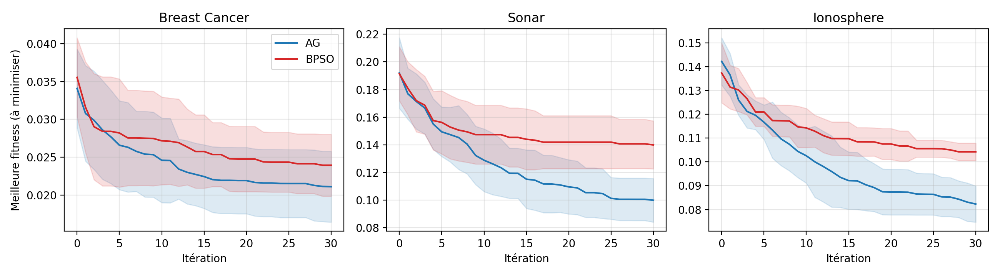

# Sélection de variables par Algorithme Génétique : comparaison avec le PSO binaire et une référence simple

[](https://colab.research.google.com/github/VOTRE_NOM_UTILISATEUR/selection-variables-ag-bpso/blob/main/notebook/projet_selection_variables.ipynb)


Projet de Master **Intelligence Artificielle et Applications (IAA)**  | Faculté des Sciences Appliquées de Ouarzazate, Université Ibn Zohr.

## Question de recherche

> Dans le cadre d'un problème de classification, l'utilisation d'un algorithme génétique pour sélectionner les variables justifie-t-elle son coût de calcul par rapport au PSO binaire et à une méthode filtre simple ?

## Méthodes comparées

| Méthode | Type | Description |
|---|---|---|
| **Toutes** | Référence | Toutes les variables, sans sélection |
| **Filtre** | Filtre | Test ANOVA F, $k$ choisi par validation croisée |
| **AG** | Wrapper | Tournoi (3), croisement uniforme ($p_c = 0{,}9$), mutation $1/N$, élitisme |
| **BPSO** | Wrapper | Fonction de transfert sigmoïde, $w : 0{,}9 \to 0{,}4$, $c_1 = c_2 = 2$, $v_{\max} = 6$ |

**Fonction objectif (à minimiser)** :

$$f(\mathbf{x}) = \alpha\,\bigl(1 - \mathrm{Acc}_{\mathrm{CV}}(S)\bigr) + (1-\alpha)\,\frac{|S|}{N}, \qquad \alpha = 0{,}99$$

## Protocole expérimental

- **Données** : Breast Cancer Wisconsin ($N = 30$), Sonar ($N = 60$), Ionosphere ($N = 34$) — UCI Machine Learning Repository.
- **Classifieur** : k-NN ($k = 5$).
- **Budget égal** : AG et BPSO disposent de 20 individus × 30 itérations, soit 620 évaluations par exécution.
- **10 répétitions** : découpage stratifié 70 % / 30 %, standardisation et sélection **sur l'apprentissage uniquement** (aucune fuite de l'ensemble de test).
- **Test statistique** : Wilcoxon apparié, bilatéral, $\alpha = 0{,}05$.

## Résultats principaux

**Précision sur le test (%, moyenne ± écart-type, 10 répétitions)**

| Jeu de données | Toutes | Filtre | AG | BPSO |
|---|---|---|---|---|
| Breast Cancer | **96,3 ± 1,4** | 96,0 ± 1,6 | 96,0 ± 1,8 | 96,0 ± 1,3 |
| Sonar | 80,0 ± 4,6 | 77,6 ± 5,4 | **81,3 ± 6,4** | 79,4 ± 5,3 |
| Ionosphere | 83,3 ± 2,1 | 86,8 ± 5,0 | **88,0 ± 3,6** | 87,0 ± 2,6 |

**Nombre de variables sélectionnées (moyenne)**

| Jeu de données | Toutes | Filtre | AG | BPSO |
|---|---|---|---|---|
| Breast Cancer | 30 | 22,0 | **13,3** | 14,3 |
| Sonar | 60 | 29,4 | **25,9** | 28,5 |
| Ionosphere | 34 | **6,8** | 7,8 | 9,5 |



### Conclusions

1. **Précision** : ni l'AG ni le BPSO n'améliorent significativement la précision du filtre, sur aucun jeu de données.
2. **AG vs BPSO** : aucune différence de précision significative ; les moyennes favorisent l'AG sur 2 des 3 jeux.
3. **Coût** : la sélection par métaheuristique est **44 à 78 fois plus lente** que le filtre.
4. **Point fort** : sur Ionosphere, l'AG et le BPSO dépassent significativement la référence Toutes ($p = 0{,}004$) avec environ 8 à 9 variables sur 34.

Du point de vue de la précision, le surcoût des métaheuristiques n'est pas justifié dans ce cadre ; l'AG produit toutefois des sous-ensembles plus compacts sur 2 des 3 jeux.

## Reproduire les expériences

**Option 1 — Google Colaab** : cliquer sur le badge « Open in Colab » ci-dessus, puis `Exécution > Tout exécuter`.

**Option 2 — En local** :

```bash
git clone https://github.com/VOTRE_NOM_UTILISATEUR/selection-variables-ag-bpso.git
cd selection-variables-ag-bpso
pip install -r requirements.txt
jupyter notebook notebook/projet_selection_variables.ipynb
```

Les jeux de données sont téléchargés automatiquement (OpenML, avec repli sur l'UCI). Toutes les graines aléatoires sont fixées : les précisions et nombres de variables sont reproductibles à l'identique ; seuls les temps de calcul varient selon la machine.

## Structure du dépôt

```
selection-variables-ag-bpso/
├── notebook/
│   └── projet_selection_variables.ipynb   # code complet des expériences
├── rapport/
│   ├── main.tex                           # rapport LaTeX (Overleaf)
│   ├── references.bib                     # bibliographie
│   ├── resultats_auto.tex                 # tableaux et résultats insérés dans le rapport
│   └── figures/
├── resultats/
│   ├── resultats_bruts.csv                # une ligne par méthode, jeu et répétition
│   ├── resume.csv                         # moyennes et écarts-types
│   ├── wilcoxon.csv                       # valeurs p
│   └── figures/
├── requirements.txt
├── CITATION.cff
└── LICENSE
```

## Principales références

- I. Guyon et A. Elisseeff, *An Introduction to Variable and Feature Selection*, JMLR, 2003.
- R. Kohavi et G. H. John, *Wrappers for Feature Subset Selection*, Artificial Intelligence, 1997.
- J. Kennedy et R. C. Eberhart, *A Discrete Binary Version of the Particle Swarm Algorithm*, IEEE SMC, 1997.
- B. Xue et al., *A Survey on Evolutionary Computation Approaches to Feature Selection*, IEEE TEVC, 2016.
- İ. Babaoğlu et al., *A Comparison of Feature Selection Models Utilizing BPSO and GA…*, Expert Systems with Applications, 2010.

La bibliographie complète se trouve dans [`rapport/references.bib`](rapport/references.bib).

## Auteurs

- **Hamza Oukhasha**
- **EL-JANDOUZ HASSANE**

## Licence

Code sous licence [MIT](LICENSE).
